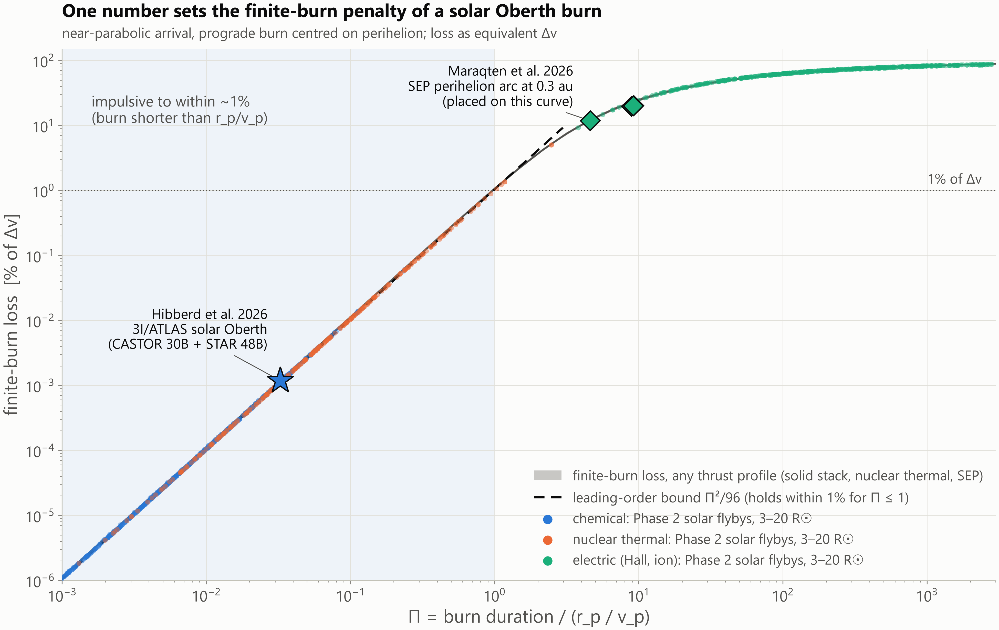
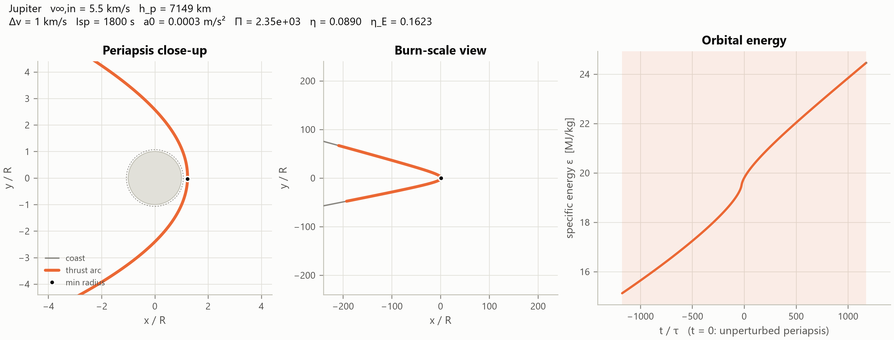
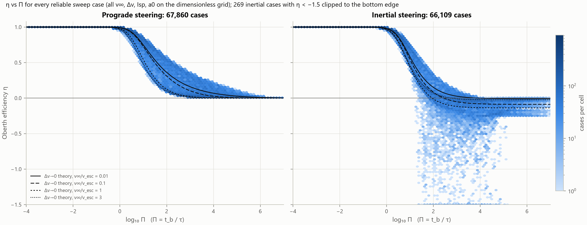
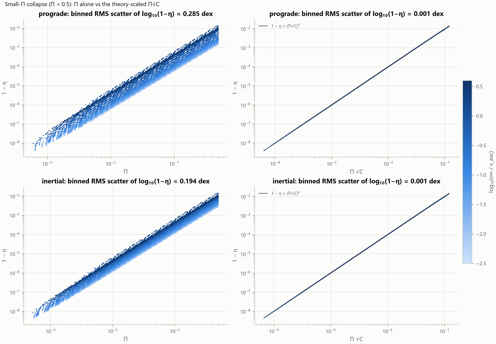
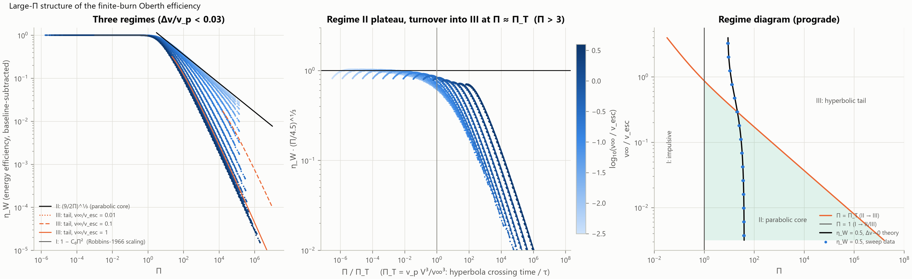
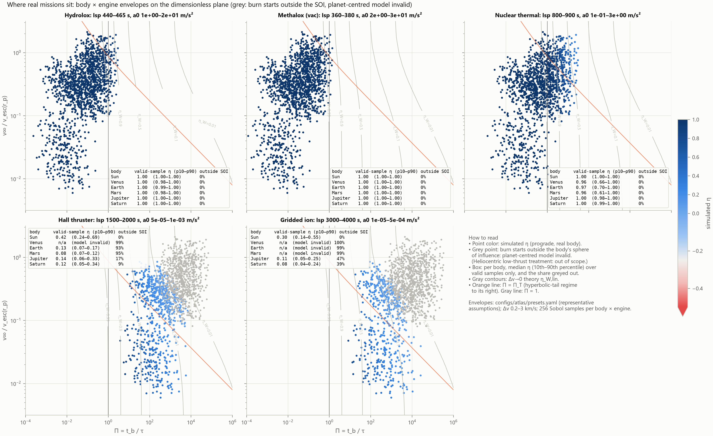
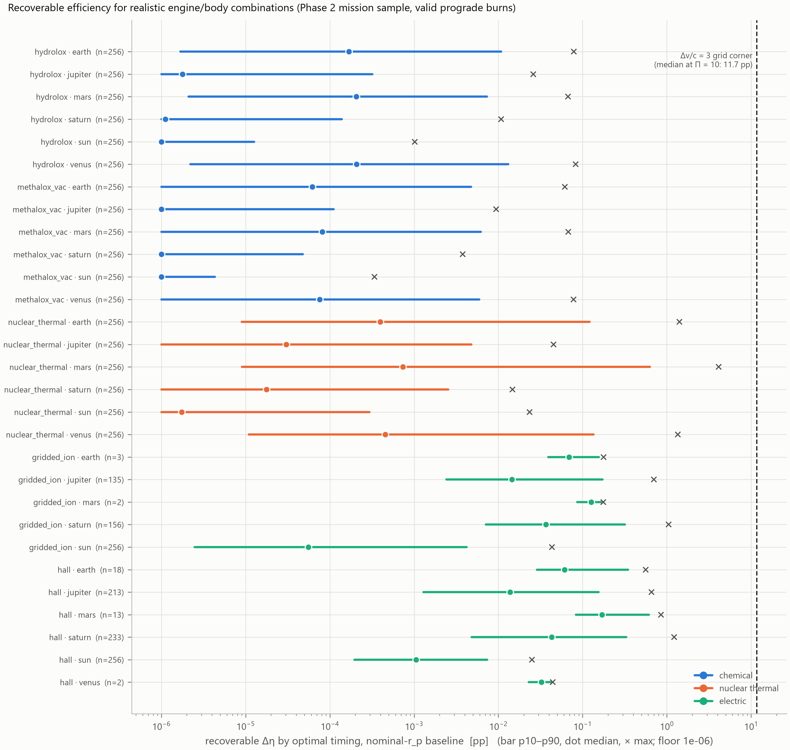
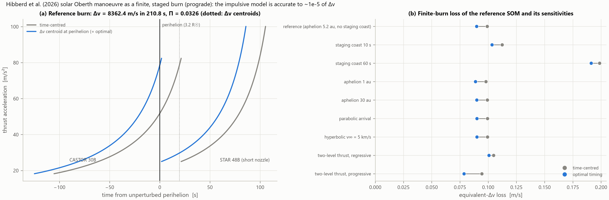
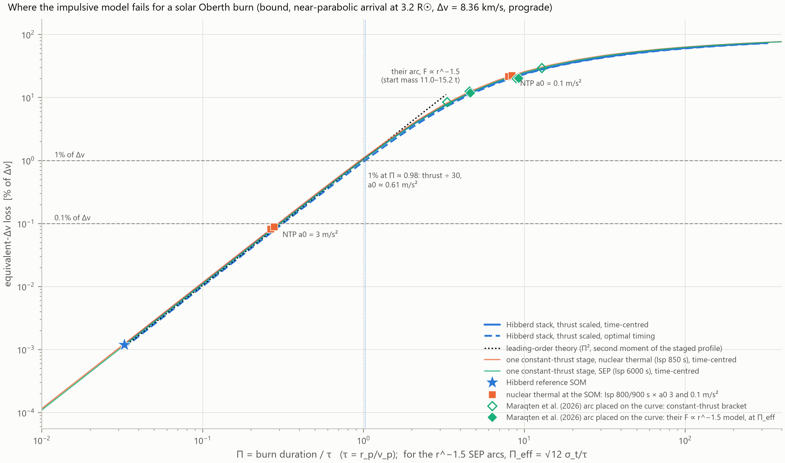
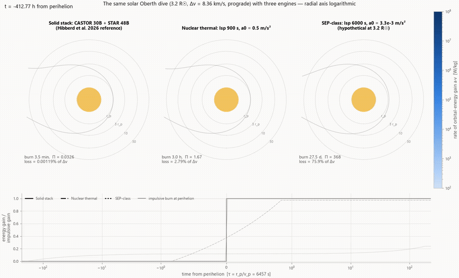

# Oberth Efficiency Atlas

**How much of the impulsive Oberth benefit survives a finite-duration burn?**



*Finite-burn loss of a prograde solar Oberth burn against Π = burn duration / (r_p / v_p). Dots are
simulated flybys with chemical, nuclear thermal and electric engines; the star is the 3I/ATLAS burn
proposed by Hibberd et al. (2026); the diamonds place the solar-electric arc of Maraqten et al.
(2026) on the curve. All thrust profiles fall on one curve.*

Near periapsis, a spacecraft reaches its highest speed, so a given velocity increment (Δv) can produce a greater energy gain than the same increment applied in deep space. This is the Oberth effect. Mission-design calculations often approximate the maneuver as instantaneous, but real engines operate over finite intervals—from minutes for chemical propulsion to hours for nuclear thermal propulsion and weeks or months for electric propulsion. During a burn, the spacecraft continues moving while gravity changes the direction and magnitude of its velocity.

This project quantifies how much of the impulsive Oberth benefit remains when thrust is applied over a finite duration. The analysis combines a high-precision flyby simulator, a 135,720-run dimensionless parameter sweep, 15,360 mission samples across six central bodies and five propulsion classes, closed-form analytical results, burn-optimization experiments, and a solar Oberth case study.

## Summary of findings

- **The dimensionless parameter Π = t_b / τ organizes the finite-burn penalty.** Here, τ = r_p / v_p is the characteristic time to travel one periapsis radius at periapsis speed. For Π below about 1, the loss is approximately 1% or less under the stated assumptions. Losses increase as Π exceeds 1, and energy efficiency falls to roughly one half at Π ≈ 10–40.
- **Chemical engines remain close to the impulsive limit** across all six modeled bodies. Median η is about 0.999 or better at
  all six bodies.
- **Nuclear-thermal propulsion shows measurable losses near the terrestrial planets** (median η ≈ 0.96–0.97, 10th
  percentile 0.6–0.7) and impulsive at the Sun and the giants.
- **Electric propulsion departs substantially from the impulsive limit.** Where the model applies they keep roughly 8–42% of the
  bonus. At Venus, Earth and Mars most of their burns start outside the sphere of influence, so the
  planet-centred model does not apply at all.
- **Burn-timing optimization recovers little efficiency for the modeled realistic missions.** For realistic engines the median gain from
  optimizing burn timing is below 0.01 percentage points for every engine class.
- **The modeled 3I/ATLAS solar Oberth burn remains close to the impulsive limit.** It loses 0.1 m/s of 8.36 km/s.
- **Fixed-direction thrust can substantially alter the flyby geometry.** For long burns it pulls periapsis down, even into the
  planet, and η goes negative.

The **Oberth efficiency** is defined as η = B_finite / B_imp. Here, B = v∞,out − (v∞,in + Δv) represents the speed gained beyond the corresponding deep-space burn. Thus, η = 1 represents the impulsive benchmark, η = 0 indicates no additional gain over deep space, and η < 0 indicates a worse outcome. Values are not clipped. For bound arrivals, where η is undefined, the analysis instead reports the **equivalent-Δv loss**: the additional velocity increment required to match the impulsive result.

## Simulation approach

The simulator models a planet-centered, two-body trajectory with point-mass gravity and a constant-thrust, constant-specific-impulse (Isp) engine. Spacecraft mass decreases according to the rocket equation. Burn timing is defined relative to the *unperturbed* periapsis passage, and thrust follows one of four steering laws: `prograde` (aligned with velocity), `inertial` (a fixed direction), or one of two pitch profiles that deviate from prograde.

The integrator uses nondimensional units (μ = r_p = 1). Each run is described by four dimensionless groups based on arrival speed, Δv, exhaust velocity, and thrust acceleration, scaled to periapsis conditions. This makes the core simulator **independent of the central body**: the same parameter sweep can be applied across bodies, with each body contributing its physical scale, impact radius, and sphere-of-influence constraint. DOP853 integrates the coast, burn, and post-burn coast phases with a tolerance of 1e-12. An energy-balance residual is recorded for every run to help identify numerical errors.

**Example configuration:** `configs/earth_hydrolox.yaml` models a 1 km/s hydrolox burn (Isp = 465 s, a₀ = 2 m/s²) centered on periapsis at an altitude of 300 km above Earth, with an arrival speed of 3 km/s.

| | Earth, hydrolox | Jupiter, Hall thruster |
|---|---|---|
| burn duration | 449 s | 37.5 days |
| **Π** | **0.762** | **2350** |
| **η** | **0.9917** | **0.089** |
| loss in equivalent Δv | 14.2 m/s | 5.1 km/s |

For the same 1 km/s velocity increment, the modeled hydrolox burn retains 99% of the Oberth benefit, compared with 9% for the Hall thruster.



In the Jupiter case, the burn extends roughly 200 planetary radii on either side of periapsis. Energy increases almost linearly over time, with only a small change near periapsis. Most of the thrust is applied far from the planet, where the Oberth benefit is comparatively small.

## Results and analysis

### Overall relationship between η and Π



The plot shows every reliable sweep case, with prograde steering on the left, inertial steering on the right, and the Δv → 0 analytical result in black. For Π ≪ 1, efficiency remains close to η = 1 and declines as Π exceeds 1. Under prograde steering, η decreases smoothly toward zero without becoming negative. Inertial steering follows a similar trend until Π ≈ 10, after which the behavior diverges: 33% of inertial cases at Π = 10–10³ and 95% of cases at Π ≥ 10³ have η < 0, reaching −24. Because fixed-direction thrust changes the flyby geometry, it represents a distinct dynamical regime rather than simply a less efficient version of prograde thrust.

### Why Π organizes the results

For burns near periapsis, finite-burn losses arise because gravity changes the velocity direction and the spacecraft speed decreases away from periapsis. At small Π, these effects produce a loss proportional to Π². For a prograde burn centered on periapsis and a small Δv:

> loss / Δv ≈ k(1 − k) Π² / 24, where k = μ / (r_p v_p²) ≤ ½.

The coefficient is largest at k = ½, corresponding to a near-parabolic arrival, giving **loss/Δv ≲ Π²/96**. This provides a useful rule of thumb: a loss of about 1% at Π = 1. The estimate applies to prograde steering for burns centered on periapsis, with Π ≲ 1 and small Δv/v_p and Δv/c; it is accurate to within about 10% for Δv/v_p ≲ 0.03 and Δv/c ≲ 1. It does not apply to fixed-direction thrust.



Plotting 1 − η against Π alone leaves 0.285 dex of scatter for prograde cases because the prefactor also depends on arrival speed, Δv, and mass ratio. Rescaling by the closed-form prefactor C collapses all 15,375 prograde points onto a single line, 1 − η = (Π√C)², with 0.001 dex of scatter. For Π < 0.01, the prefactor is accurate to approximately 1e-3. A simpler estimate based on losses along the unperturbed trajectory underestimates the loss by a median of 14% for prograde burns, and by as much as a factor of 4.4 when Δv ≳ v_p.

After this rescaling, **arrival speed is the main remaining explanatory parameter**: v∞/v_esc explains 73–92% of the
scatter left within each Π range (prograde). Slow arrivals lose most, because the coefficient
k(1 − k)/24 peaks at k = ½, the near-parabolic arrival. The loss reaches 1% of Δv at Π = 0.99 for
v∞/v_esc = 0.01 but only at Π = 3.6 for v∞/v_esc = 3.3, and at Π = 10 the median loss is 24% against
2.2% (`figures/loss_vs_pi_vinf.png`).

### Behavior at large Π



When the burn lasts longer than the spacecraft spends near the planet, much of the velocity increment is delivered far from periapsis, where the Oberth benefit is small. The sweep reveals three regimes:

| regime | range | efficiency (η, or the energy efficiency η_W) |
|---|---|---|
| I, impulsive | Π ≪ 1 | 1 − CΠ² |
| II, parabolic core | 1 ≪ Π ≪ Π_T | (9 / 2Π)^(1/3), about 1.65 Π^(−1/3) |
| III, hyperbolic tail | Π ≫ Π_T | ~ ln Π / Π |

Here, Π_T is the hyperbolic crossing time expressed in units of τ. Regime II therefore occurs only for slow arrivals (v∞ ≪ v_esc).
The half-efficiency point (η_W = ½) sits at Π ≈ 8–40 across the whole sweep, with a median of 26,
and the Δv → 0 theory predicts it to 0.4% median error.

### Position of representative propulsion systems



Each panel represents one propulsion class, with 256 Sobol samples per central body colored by simulated η. Gray points indicate burns that begin outside the central body’s sphere of influence, where the body-centered model is not valid. The propulsion and central-body parameter ranges in `configs/atlas/presets.yaml` are **representative modeling assumptions**, not hardware specifications.

The table reports median η and the 10th–90th percentile range for valid prograde samples. Where some samples are invalid, the number of valid cases is also shown. See `figures/mission_table.csv` for the complete table.

| body | Hydrolox | Methalox | Nuclear thermal | Hall | Gridded ion |
|---|---|---|---|---|---|
| Sun | 1.0000 (1.000–1.000) | 1.0000 (1.000–1.000) | 1.0000 (0.999–1.000) | 0.4198 (0.239–0.685) | 0.2995 (0.136–0.550) |
| Venus | 0.9990 (0.984–1.000) | 0.9998 (0.996–1.000) | 0.9592 (0.663–0.998) | n/a (0/256 valid) | n/a (0/256 valid) |
| Earth | 0.9992 (0.987–1.000) | 0.9998 (0.997–1.000) | 0.9677 (0.700–0.999) | 0.1322 (0.069–0.167) [18/256 valid] | n/a (0/256 valid) |
| Mars | 0.9990 (0.980–1.000) | 0.9997 (0.995–1.000) | 0.9553 (0.615–0.998) | 0.0784 (0.069–0.117) [13/256 valid] | n/a (0/256 valid) |
| Jupiter | 1.0000 (1.000–1.000) | 1.0000 (1.000–1.000) | 0.9995 (0.978–1.000) | 0.1387 (0.058–0.329) [213/256 valid] | 0.1062 (0.051–0.251) [135/256 valid] |
| Saturn | 1.0000 (1.000–1.000) | 1.0000 (1.000–1.000) | 0.9997 (0.989–1.000) | 0.1178 (0.046–0.336) [233/256 valid] | 0.0848 (0.039–0.235) [156/256 valid] |

The results are primarily organized by Π. Chemical burns generally have Π ≲ 1 and remain close to the impulsive limit. Nuclear-thermal burns approach Π ~ 1 near the terrestrial planets, where τ is short—about 10 minutes at Earth—and incur losses of several percent. Electric burns typically have Π ~ 10²–10⁴ and retain only a few to a few tens of percent of the Oberth benefit. Most electric-propulsion cases at Venus, Earth, and Mars fall outside the model’s valid range because the burn begins beyond the sphere of influence.

### Can burn optimization recover the lost efficiency?



An optimizer searched for the best burn within the tested prograde-family profiles, subject to a minimum-altitude constraint. The search considered timing alone and timing combined with a linear pitch law (450 optimizations, cross-checked against Nelder–Mead). Applied to the mission samples, optimal timing produced the following **median** gains in η:

| engine class | median gain | maximum |
|---|---|---|
| chemical | 7e-6 pp | 0.083 pp |
| nuclear thermal | 8e-5 pp | 4.1 pp |
| electric | 0.0068 pp | 1.2 pp |

Here, pp denotes percentage points of η. A more flexible pitch profile adds at most 0.07 pp. By comparison, an unrealistic corner of the controlled grid (Δv/c = 3, corresponding to a propellant fraction of approximately 95%) achieves a median gain of 11.7 pp at Π = 10.

The mechanism follows from the distribution of Δv over time. At small Π, the loss depends on burn placement through the spread of that distribution, so the optimum aligns the **Δv-weighted centroid**, rather than the temporal midpoint, with periapsis.
A rocket's acceleration rises as it burns off mass, so the centroid sits after the midpoint and the
best burn starts slightly early. The recovered share of the deficit has a closed form: 0.08%, 7.6% and
39.7% at Δv/c = 0.1, 1 and 3. A simple "half the Δv before periapsis" rule captures 75–80% of that
gain. Only 322 of 5,895 valid mission samples gain more than 0.1 pp, and all of them do so by
starting *later*. The gain tracks how far the centred burn lifts periapsis (Spearman 0.91).

For the realistic engine cases studied here, centering the burn near periapsis is generally sufficient; additional steering and timing optimization recover little of the lost efficiency.

### Case study: solar Oberth maneuver for 3I/ATLAS

Hibberd et al. (2026) propose a solar Oberth maneuver at 3.2 R☉ to intercept the interstellar object 3I/ATLAS. Their concept delivers Δv = 8.36 km/s using a CASTOR 30B + STAR 48B stack on a bound arrival from 5.2 au and treats the burn as impulsive. The `staged.py` model simulates the two-stage burn through perihelion.



The modeled burn lasts 210.8 s, corresponding to Π = 0.0326. It loses **0.099 m/s** relative to the 8.36 km/s impulsive benchmark (1.2e-5 of Δv), decreasing to 0.090 m/s with optimized timing. The loss remains below 0.2 m/s across all tested sensitivities; the largest occurs with a 60-second coast between stages. Under these assumptions, the impulsive approximation is well justified.



Thrust-scaling experiments quantify the margin between this case and one with a meaningful finite-burn penalty. The loss reaches 1% of Δv at Π ≈ 0.98, which for
this stack means about **30 times less thrust**. A single nuclear-thermal stage reaches 1% at
a₀ ≈ 0.83–0.88 m/s². The curve is nearly universal: a two-stage solid stack, a constant-thrust
nuclear stage and a solar-electric stage lie within 8% of each other from Π = 0.1 to 100. Maraqten et
al.'s solar-electric arc never assumed an impulsive burn, but on this curve it sits at Π ≈ 4.6–9.2,
where the loss is about 12–20%.



The animation compares the same solar dive using a solid-propellant stack (Π = 0.03, loss 0.001%), a nuclear-thermal engine (Π = 1.7, loss 2.8%), and a hypothetical solar-electric engine (Π = 368, loss 76%).
([MP4](figures/anim_engines.mp4))

### Fixed-direction thrust and comparison with prior work

For fixed-direction thrust, the leading-order loss follows the scaling attributed to Robbins (1966), (ω t_b)²Δv/24, as cited by Confraria (2020). The measured prograde loss is 0.5–1.05 times this expression and decreases with k (`figures/robbins_comparison.png`). The simulations reproduce Confraria’s substantial overestimate of the Robbins expression at low thrust-to-weight (130% at T/W₀ = 0.1), but do not reproduce the exact magnitude at higher thrust. Because the original Robbins paper was not accessible, conclusions beyond the reported scaling remain provisional. The project’s claim register is available in `docs/paper_outline.md`.

## Limitations and scope

- **Point-mass gravity.** A J2 check on 10 cases (Jupiter and Saturn, Π = 0.1–100) changes η by at
  most 0.0026.
- **Planet-centred frame.** Burns that start outside the sphere of influence are masked, not
  assigned a number.
- **Representative presets.** Engine and body envelopes are assumptions, so the mission statistics
  depend on them.
- **Case study.** Planar point-mass Sun, constant thrust per motor, an unknown staging coast
  (bracketed at 10–60 s) and no thermal limits. The solar-electric engine at 3.2 R☉ in the
  animation is hypothetical.
- **Steering.** Only smooth pitch laws and one piecewise law were tested, so the optima hold within
  those families.

## Installation and usage

```bash
python -m venv .venv
.venv/Scripts/python -m pip install -e ".[dev]"     # .venv/bin/python on macOS/Linux
.venv/Scripts/python -m pytest

.venv/Scripts/oberth run configs/earth_hydrolox.yaml
```

The `oberth run` command prints the simulation metrics and writes `runs/<name>/result.json` and `trajectory.png`. Configuration files use unit-suffixed keys such as `v_inf_in_km_s`, `isp_s`, and `a0_m_s2`; the schema is defined in `src/oberth_atlas/config.py`. To run a simulation from Python:

```python
from oberth_atlas.burn import BurnSpec, Engine
from oberth_atlas.constants import get_body
from oberth_atlas.simulate import simulate_flyby

res = simulate_flyby(get_body("earth"), v_inf_in=3_000.0, periapsis_altitude=300_000.0,
                     burn=BurnSpec(delta_v=1_000.0, engine=Engine(isp=465.0, a0=2.0)))
print(res.Pi, res.eta, res.delta_v_loss)
```

**Interactive explorer.** Open `explorer/oberth_explorer.html` in a browser to run simulations for different central bodies, periapsis conditions, arrival speeds, velocity increments, and engines. The explorer displays η, the efficiency loss, the trajectory, and the case’s position on the loss curve and η atlas. Its JavaScript simulator is tested against the Python implementation.

**Data and outputs.** Generated results are committed in `results/` (Parquet files containing the parameter sweep, mission samples, optimization runs, and case study) and `figures/`. Figures from each phase have corresponding `figures/*_numbers.json` files containing the values reported in the README. Parquet metadata records provenance, including the grid, numerical settings, and Git revision. The `oberth_atlas.analysis.reliable` utility identifies sweep rows that pass the reliability checks.

**Reproducibility.** Run `scripts/rebuild_all.py` to regenerate the results, figures, and explorer in dependency order. On the eight-core audit machine, the process takes approximately 43–79 minutes. A clean-clone rebuild at the `v1.0-analysis` tag reproduced all 56 committed outputs, and `requirements-lock.txt` specifies the audited environment. See `docs/repro.md` for details.

<details>
<summary>More figures</summary>

| figure | what it shows |
|---|---|
| `eta_vs_a0.png` | η converges to 1 as thrust rises, at second order in Π (fitted order 2.000) |
| `prefactor_check.png` | the small-Π prefactor against every sweep point with Π < 0.1 |
| `collapse_secondary.png` | which secondary parameter explains the scatter left after collapsing on Π |
| `atlas_eta.png` | η on the (Π, v∞/v_esc) plane for three Δv values, prograde and inertial |
| `robbins_comparison.png` | measured loss against the Robbins expression, and Confraria's escape case |
| `phase3_timing.png`, `phase3_recoverable.png` | optimal burn offset and recoverable gain on the controlled grid |
| `phase3_fraction.png`, `phase3_pitch.png` | recovered fraction of the deficit and the optimal pitch law |
| `phase3_baselines.png`, `phase3_reversal.png` | both impulsive baselines, and the large-Π timing reversal |
| `rule_check.png` | the Π²/96 rule against the sweep and the closed-form bound over any arrival conic |
| `trajectory_*.png` | the four example configs in `configs/` |

</details>

<details>
<summary>Repository layout</summary>

```
src/oberth_atlas/   the library: constants, simulate (simulate_nd, simulate_flyby), steering, metrics,
                    theory, sweep, optimize, staged, j2, config, cli
tests/              pytest suite
configs/            single-flyby examples, atlas presets (presets.yaml), Phase 4 motor data
scripts/            one script per figure, plus run_*, rebuild_all, repro_audit, check_numbers
figures/            committed 300-dpi PNGs, CSVs and *_numbers.json
results/            committed Parquet and CSV result tables
explorer/           the interactive page (edit the template, css and js, not the built HTML)
docs/               theory.md, paper_outline.md, repro.md, ai_use_log.md
```

Physical constants (GM, radii, semi-major axes, and g₀) are maintained in `src/oberth_atlas/constants.py`, with source comments for each. Research decisions, assumptions, and unexpected findings are documented in `RESEARCH_LOG.md`; derivations are provided in `docs/theory.md`; and the literature review is in `RELATED_WORK.md`.

</details>

## Sources

- A. Hibberd, T. M. Eubanks, A. M. Hein, "Catching 3I/ATLAS Using a Solar Oberth," arXiv:2601.02533
  (2026).
- N. Maraqten et al., "High-temperature photovoltaics for solar-electric Oberth maneuvers,"
  arXiv:2608.11113 (2026).
- H. M. Robbins, "An analytical study of the impulsive approximation," *AIAA J.* 4(8) (1966).
- E. A. Willis, Jr., "Finite-thrust escape from and capture into circular and elliptic orbits," NASA
  TN D-3606 (1966), whose nondimensionalization this project follows.
- J. C. F. Confraria, "Finite burn losses in spacecraft maneuvers revisited," MSc thesis, Instituto
  Superior Técnico (2020).
- JPL Solar System Dynamics (DE440) for planetary constants.

The complete reference list is available in `docs/paper_outline.md`.
